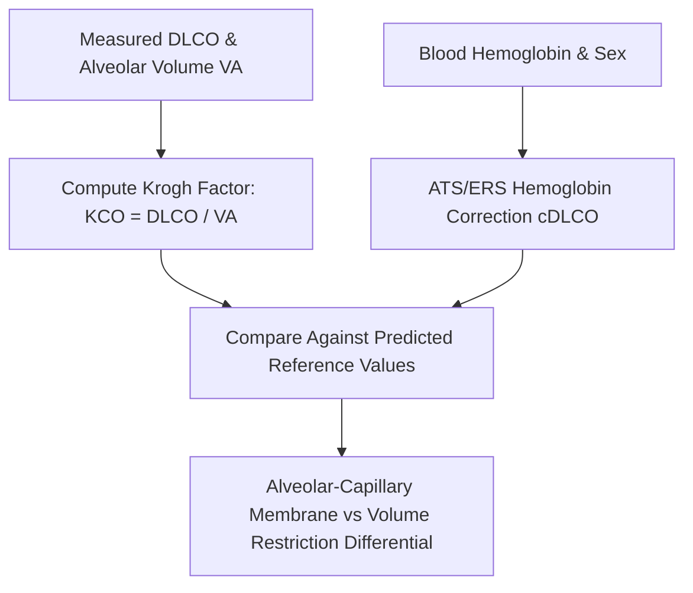

# Pulmonary Single-Breath Diffusing Capacity (DLCO) Skill

[](LICENSE)
[](https://www.python.org/)
[](https://openclaw.org/)
[](https://alphapark.ai/)
[](https://modelcontextprotocol.io/)

Single-Breath Carbon Monoxide Diffusing Capacity ($DL_{CO}$) and Krogh Transfer Factor ($K_{CO}$) Analyzer based on ATS/ERS respiratory standards.



## Features
- **Zero PIP Dependencies**: Implemented strictly with Python Standard Library (`math`, `json`, `sys`, `typing`).
- **ATS/ERS Compliance**: Exact Cotes/Dinakara equations for male and female hemoglobin adjustment.
- **Krogh Factor Discrimination**: Separates primary microvascular obliteration from mechanical restriction.
- **Dual Architecture**: Native Python import and Model Context Protocol (MCP) JSON-RPC 2.0 stdio server.

## Quickstart
```bash
python example_usage.py
```

## License
Apache-2.0
